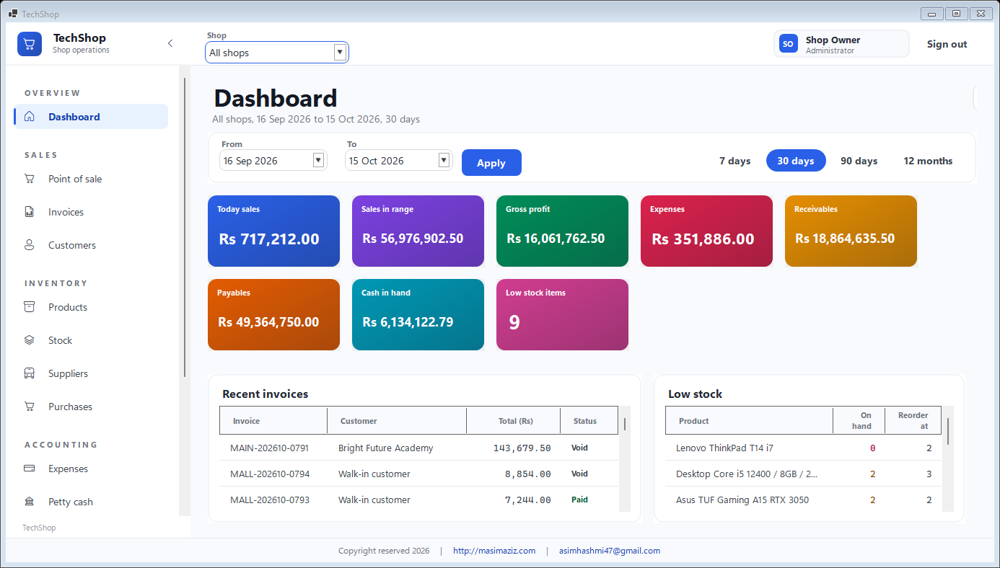
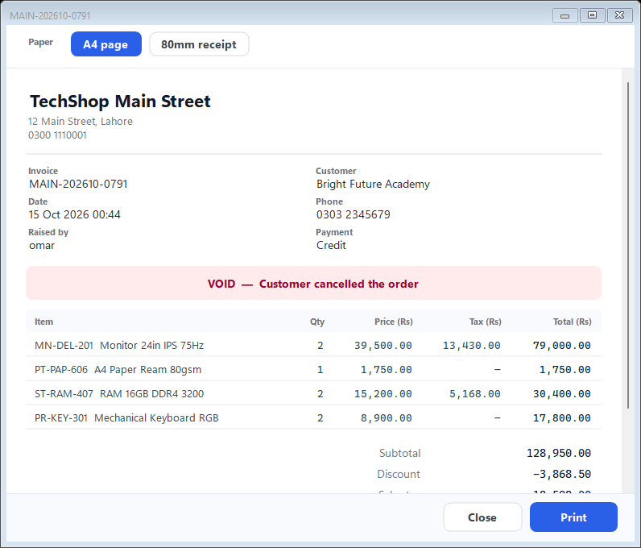
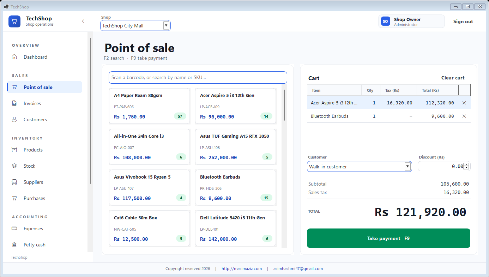

# TechShop

Multi-shop point of sale, inventory and small-business accounting, as a single Windows desktop application.

Repository: <https://github.com/asimhashmi47/Tech-Shop>

A shopkeeper running two or three branches needs the till, the stock on the shelf and the books to agree with each other. TechShop keeps them in one SQLite file: a sale at the counter moves stock, raises an invoice, posts to the customer account and lands in the cash drawer, and the balance sheet that comes out at the end is one that actually balances.



## What it does

**Selling**
- Touch-friendly till with barcode scanning or text search, and keyboard shortcuts (`F2` search, `F9` take payment)
- **Per-line sales tax** — a basket can hold a taxable item and an exempt one, each taxed on its own merits
- Cash, card, bank and credit, with live change due and part payment onto the customer account
- Invoices print as an **80mm till roll or an A4 page**, with void and full stock reversal, and a receipt ledger per customer

**Inventory**
- Products with SKU, barcode, brand, category, cost, sale price, tax status and a reorder level
- Per-shop stock with a movement history: opening, purchase, sale, adjustment, transfer and sale reversal
- Transfers between shops, stock-count adjustments, and a low-stock list on the dashboard

**Buying**
- Purchase bills that put stock on the shelf and anything unpaid onto the supplier account
- Supplier payments against a specific bill

**Accounting**
- Expenses by category, and a petty cash drawer per shop that mirrors cash movements automatically
- Profit and loss, balance sheet and a direct-method cash flow statement
- Customer and supplier ledgers that close on the same figure as the party balance

**Running the place**
- Any number of shops; every screen can show one shop or all of them
- Date range on the dashboard and the reports, with 7 / 30 / 90 day and 12 month presets
- Per-module read and write permissions for each user, enforced in the service layer, not just the menu
- Audit log of logins, edits, voids, exports and permission changes
- Currency chosen once in Settings and applied to every money figure in the app
- Excel export from every grid

## How tax works

Tax is charged **per line, not per invoice**. That is the whole point of it: a real basket is mixed, and taxing the invoice as a whole gets the answer wrong the moment one item is exempt.

- A product is marked taxable or exempt and carries a default rate
- The till prefills each line's tax from its product, and the cashier can override the amount on any line
- An exempt line shows a dash rather than `0.00`, so "no tax applies" reads differently from "tax rounded to nothing"
- The line's tax is stored as **money**, not a rate, because the operator can change it — a stored rate would stop describing what was actually charged
- Tax is added after the invoice discount and is never discounted, because the shop still owes the full amount onward

In the books, sales tax is money collected on behalf of the tax authority, so it is **not revenue**:

| Statement | Treatment |
|---|---|
| Profit and loss | Revenue is the invoice total **less** the tax charged on it |
| Balance sheet | Tax collected appears as a liability, "Sales tax collected, not yet paid over" |
| Receivables | **Gross** — a customer on credit owes the tax too |

## Printing

An invoice prints in two formats, chosen in the preview before anything reaches the printer:

| | |
|---|---|
| **80mm receipt** | What the counter prints. Each item takes two lines — the name, then the arithmetic — because three columns will not fit across 80mm without truncating product names into uselessness. The page is sized to its content, so a till roll is not fed and cut with a strip of blank paper after every sale. |
| **A4 page** | The office copy. Full item table with per-line tax, and the totals block. |

The till defaults to the receipt and the Invoices screen defaults to A4, since that is the paper each one usually has loaded. One renderer draws both the preview and the paper, so what is checked on screen is what comes out.



## Screens

| | |
|---|---|
| Dashboard | Eight KPI cards that link through to the rows behind them, recent invoices, low stock |
| Point of sale | Product shelf, cart with per-line tax, payment and change |
| Invoices, Customers | Lists, invoice print view, void, take payment, customer ledgers |
| Products, Stock | Catalogue with tax status, per-shop stock, adjustments, transfers, movement history |
| Suppliers, Purchases | Supplier accounts and ledgers, bill entry that receives stock, supplier payments |
| Expenses, Petty cash | Category spend and drawer movements |
| Reports | Period summary, profit and loss, balance sheet, cash flow |
| Shops, Users, Settings, Audit log | Admin, including the per-module permission matrix |

Every screen is in [`images/`](images/), captured from the running application:

| | | |
|---|---|---|
| [Sign in](images/01-login.png) | [Dashboard](images/02-dashboard.png) | [Point of sale](images/03-point-of-sale.png) |
| [Invoices](images/04-invoices.png) | [Customers](images/05-customers.png) | [Products](images/06-products.png) |
| [Stock](images/07-stock.png) | [Suppliers](images/08-suppliers.png) | [Purchases](images/09-purchases.png) |
| [Expenses](images/10-expenses.png) | [Petty cash](images/11-petty-cash.png) | [Reports](images/12-reports.png) |
| [Shops](images/13-shops.png) | [Users](images/14-users.png) | [Audit log](images/15-audit-log.png) |
| [Settings](images/16-settings.png) | [Invoice, A4](images/17-invoice-a4.png) | [Invoice, 80mm](images/18-invoice-receipt-80mm.png) |



## Tech stack

- **.NET 10**, Windows Forms, per-monitor v2 DPI
- Clean Architecture: `Domain` ← `Application` ← `Infrastructure` ← `WinForms`
- **EF Core 10** with SQLite in WAL mode; migrations run on first start
- [Krypton Toolkit](https://github.com/Krypton-Suite/Standard-Toolkit) for inputs and dialogs; the sidebar, KPI cards, buttons, chips, toasts and grids are drawn by the app
- BCrypt password hashing, ClosedXML for Excel export
- Icons come from the system Segoe Fluent Icons font, so the app ships no image assets and scales at any DPI
- Design tokens converted from the OKLCH palette the web original used, so the colours are the same values rather than approximations

There is no server and no web layer. The UI calls the application services directly through dependency injection; each screen owns one DI scope, and therefore one EF Core change tracker, for as long as it is open.

## Architecture

```
TechShop/
├── Directory.Build.props              net10.0, nullable, warnings as errors
├── .editorconfig                      analyzer rules; generated migrations excluded
├── src/
│   ├── TechShop.Domain/               entities, enums, no dependencies
│   ├── TechShop.Application/          services, DTOs, query contract, validation
│   ├── TechShop.Infrastructure/       EF Core, migrations, seeding, permissions, Excel
│   └── TechShop.WinForms/             shell, theming, controls, one folder per screen
└── tests/
    └── TechShop.QaHarness/            headless UI and data QA (see below)
```

Grids share one contract. Every list screen builds a `QueryRequest` and the service runs it against a per-resource `QuerySpec` whitelist, so paging, sorting and filtering happen **in SQLite** and a shop with two years of movements opens as fast as a new one. Fields are matched against the whitelist before any expression is built, so a filter cannot reach a column the screen was never given.

## Prerequisites

- Windows 10 or 11
- [.NET SDK 10](https://dotnet.microsoft.com/download) or newer

No database server is needed. SQLite is a file, and migrations plus the demo seed run on first start.

## Quick start

```bash
dotnet run --project src/TechShop.WinForms
```

The database is created at `%LOCALAPPDATA%\TechShop\techshop.db` and seeded with six months of trading, so every screen and report has real figures on first run. Delete that folder to start again.

To build a self-contained executable:

```bash
dotnet publish src/TechShop.WinForms -c Release -r win-x64 --self-contained -p:PublishSingleFile=true
```

## Demo accounts

Seeded for local use only.

| Username | Password | Access |
|---|---|---|
| `admin` | `admin123` | Everything, including users, settings and the audit log |
| `sara` | `sara` | Writes POS, invoices, customers. Reads dashboard, products, stock. Shop 1 |
| `bilal` | `bilal` | Writes POS, invoices, customers, expenses, petty cash. Reads reports. Shop 2 |
| `hina` | `hina` | Writes products, stock, purchases, suppliers. Reads invoices, reports. Both shops |
| `omar` | `omar` | Writes expenses, petty cash. Reads reports, invoices. Both shops |
| `zoya` | `zoya` | Read only, shop 1 |

**Change these before putting the app anywhere real.** They are deliberately weak seed data for evaluating the permission matrix, not defaults to deploy.

## Seeded data

A fresh database gets two shops, six accounts and six months of trading:

| | |
|---|---|
| Products / categories | 60 / 8, a mix of taxable at 17% and exempt |
| Customers / suppliers | 20 / 8 |
| Invoices | ~800 across six months, in all four statuses including voids |
| Purchase bills | Weekly restocking runs per shop, some part-paid |
| Stock movements | ~2,300, covering all eight movement types |
| Expenses, petty cash | Monthly bills, with the drawer banked weekly |
| Audit log | ~750 entries |

History is generated one day at a time, so the shop reorders what has run low, sells, pays its bills and banks the takings in the order a real week happens. Seeding takes about 15 seconds.

## Roles and permissions

Two roles. **Admin** has everything and is the only role that can reach Users, Settings and the Audit log. **Standard** gets read or write per module, granted by an admin on the Users screen.

Modules: Dashboard, Shops, Products, Stock, Pos, Invoices, Customers, Suppliers, Purchases, Expenses, PettyCash, Reports, Users, AuditLog, Settings.

Permission is enforced in the application services. Hiding a menu item is a convenience; the service refuses the call either way, and the same check decides which shops a user may see.

## QA

The app ships with a headless QA harness. It builds the real DI container against a temporary database, signs in, then constructs every screen, forces a full paint, and inserts records **through the real dialogs** — typing into the actual inputs and pressing the actual Save.

```bash
dotnet run --project tests/TechShop.QaHarness
```

It exits non-zero on any failure.

- `-- --shots qa-screens` writes a PNG of every page at two window sizes, which is how layout gets reviewed without a person sitting in front of the running app
- `-- --images images` captures the application as a person sees it — the sign-in screen and the whole shell for every menu entry — which is what regenerates the screenshots above

Current run: **289 checks**, covering

- data integrity — stock reconciles with its movements, invoices reconcile with their lines, tax reconciles with its lines, no exempt product is ever taxed, no drawer goes negative
- every screen loads and paints at desktop and laptop size, with assertions that grids are actually sized and nothing overflows the window
- inserts through each editor dialog, checking the row lands and every field round-trips
- selling through the till end to end: cart, mixed-tax basket, discount, payment, stock, receipt, drawer
- tax behaviour in the cart: the default follows the quantity, an override is never silently recalculated, and voiding a taxed invoice removes the liability it created
- validation surfaces under the right field rather than being swallowed
- permissions refused in the service layer, not just hidden in the menu
- invoice printing in both formats, measured so a layout cannot run off the roll
- every dialog opens inside the screen's working area, footer and all, checked against a 1366x768 laptop
- load: 300 products and 250 sales inserted, then paging over ~1,000 invoices measured on the first page and the last

Why it exists: a WinForms app compiles happily with a screen that throws the moment it is painted, and most of this app's drawing happens in `Paint` handlers that never run until something asks for pixels. Running the app by hand finds those one at a time.

## Security notes

- Passwords are hashed with BCrypt and are never logged
- Every list query is matched against a field whitelist before an expression is built
- Permission and shop-scope checks live in the service layer; the UI only decides what to show
- Logins, failures, edits, voids, exports and permission changes are written to the audit log
- Anything that escapes the UI thread is written to `%LOCALAPPDATA%\TechShop\crash.log` before the process goes

## Roadmap

- Receipts, Receivables and Payables as screens of their own — the services and ledgers exist, the data is reachable today through the customer and supplier ledgers
- Charts on the dashboard and the reports
- Due dates on invoices, so ageing runs from the date the money was actually due
- Tax registration numbers and a tax summary report for filing
- Barcode label printing
- A dark theme using the existing token layer

## License

MIT. See [LICENSE](LICENSE).

---

Copyright reserved 2026 &nbsp;|&nbsp; <http://masimaziz.com> &nbsp;|&nbsp; asimhashmi47@gmail.com
